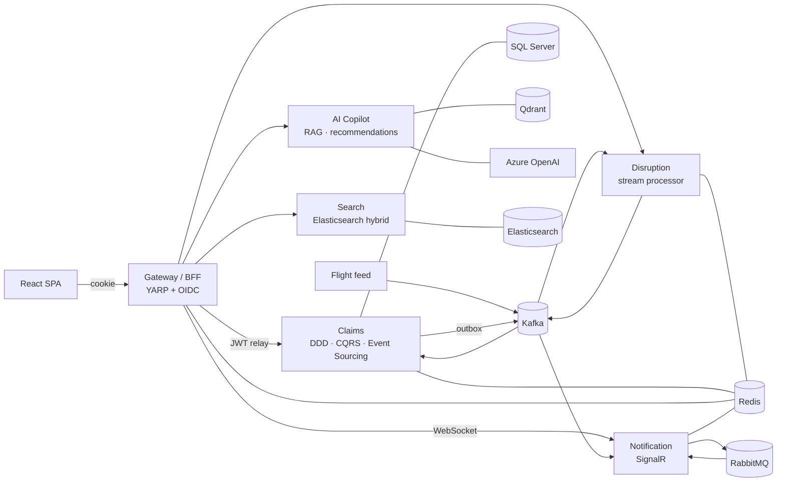

# Reroute ✈️ → 🚆 → 🏨

**Real-time travel-disruption platform with EU261 compensation claims and an AI rights copilot.**
Reroute detects flight disruptions from a Kafka stream in under a second. It alerts affected travellers live, ranks rebooking alternatives, and files event-sourced EU261 claims (€250–€600). An AI copilot explains passenger rights with citations.

> Personal portfolio project: event-driven microservices on .NET 10 + React 19, deployable to Azure (AKS).



## What's inside

| Area | Highlights | Where |
|---|---|---|
| **Domain** | EU261 rules engine as a pure domain policy; event-sourced `Claim` aggregate | [`Reroute.Claims.Domain`](src/Services/Claims/Reroute.Claims.Domain) |
| **CQRS** | Own dispatcher + pipeline behaviours (tracing, validation); Dapper read model + HybridCache (L1 + Redis) | [`BuildingBlocks/Cqrs`](src/BuildingBlocks/Reroute.BuildingBlocks/Cqrs), [`ReadModel`](src/Services/Claims/Reroute.Claims.Infrastructure/ReadModel) |
| **Event sourcing** | SQL Server event store, optimistic concurrency via a unique `(StreamId, Version)`, inline projection, transactional outbox | [`EventStore`](src/Services/Claims/Reroute.Claims.Infrastructure/EventStore), [`Outbox.cs`](src/BuildingBlocks/Reroute.BuildingBlocks/Messaging/Outbox.cs) |
| **Kafka** | Idempotent producer, manual-commit consumer, inbox dedupe, retries → DLQ, trace propagation | [`Messaging`](src/BuildingBlocks/Reroute.BuildingBlocks/Messaging) |
| **RabbitMQ** | MassTransit 8 work queues with retry/error queues; same code runs on Azure Service Bus | [`Notification`](src/Services/Notification/Reroute.Notification.Api) |
| **Redis** | Lua compare-and-set for out-of-order events, idempotency keys, SignalR backplane, semantic cache | [`FlightStateStore.cs`](src/Services/Disruption/Reroute.Disruption.Api/Detection/FlightStateStore.cs) |
| **Security** | BFF with OIDC Authorization Code + PKCE, HttpOnly cookie, CSRF header, token relay, per-user rate limits, IDOR-safe handlers | [`Gateway`](src/Gateway/Reroute.Gateway/Program.cs) |
| **AI** | RAG with structure-aware chunking, Qdrant filters, citations, injection hardening; embedding-based recommender; offline "Fake" provider | [`Copilot`](src/Services/Copilot/Reroute.Copilot.Api) |
| **Search** | Elasticsearch BM25 + geo + kNN fused with Reciprocal Rank Fusion | [`HotelSearch.cs`](src/Services/Search/Reroute.Search.Api/HotelSearch.cs) |
| **Frontend** | Feature-sliced React 19, TanStack Query, Zustand, Zod-validated API layer, SSE streaming, SignalR → cache | [`web/`](web) |
| **Ops** | OpenTelemetry → Collector → Prometheus/Tempo/Loki → Grafana; SLO burn-rate alerts | [`deploy/observability`](deploy/observability) |
| **Delivery** | Docker (chiseled, non-root), Kustomize (HPA, PDB, NetworkPolicies, Workload Identity), Bicep, GitHub Actions | [`deploy/`](deploy), [`infra/`](infra), [`.github/`](.github) |

## Run it

Prerequisites: .NET 10 SDK, Node 24, Docker.

```bash
cp .env.example .env
```

```bash
docker compose up -d --build
```

```bash
cd web && npm install && npm run dev
```

**No Docker? Use mock mode.** The UI runs against a fake in-browser backend (sample claims, live toasts, streaming copilot):

```bash
cd web && npm install && npm run dev:mock
```

In mock mode you're signed in automatically. With the real stack, open http://localhost:5173 and log in as `traveller` / `traveller`. AI runs offline by default (`AI_PROVIDER=Fake`). Set `OpenAI` or `AzureOpenAI` in `.env` to use a real model.

| URL | |
|---|---|
| http://localhost:3000 | Grafana (dashboards, traces, logs) |
| http://localhost:8085 | Kafka UI |
| http://localhost:15672 | RabbitMQ (guest/guest) |
| http://localhost:8025 | Mailpit (captured emails) |
| http://localhost:8081 | Keycloak (admin/admin) |

## Test it

```bash
dotnet test --project tests/Reroute.Claims.UnitTests
```

```bash
dotnet test --project tests/Reroute.Claims.IntegrationTests
```

```bash
cd web && npm test
```

Integration tests use Testcontainers and need Docker running.

## Design documentation
1. [Project idea & positioning](docs/01-project-idea.md)
2. [Architecture, communication & user flow](docs/02-architecture.md)
3. [Microservices](docs/03-microservices.md)
4. [Frontend](docs/04-frontend.md)
5. [Backend (Clean Architecture, DDD, CQRS, ES)](docs/05-backend.md)
6. [Database & indexing](docs/06-database.md)
7. [Kafka, RabbitMQ, Redis & caching](docs/07-messaging-caching.md)
8. [AI: RAG, embeddings, recommendations](docs/08-ai.md)
9. [Docker & Kubernetes](docs/09-containers-k8s.md)
10. [Azure](docs/10-azure.md)
11. [Observability](docs/11-observability.md)
12. [CI/CD](docs/12-cicd.md)
13. [Testing](docs/13-testing.md)
14. [Resume impact](docs/14-resume.md)
15. [Solo build roadmap](docs/15-roadmap.md) · [ADRs](docs/adr/README.md)

## Measured results
_Fill in from k6 and Grafana. Only publish numbers you measured._

| Metric | Result |
|---|---|
| Claims list p99 @ 500 RPS | _tbd_ |
| Disruption → toast p95 | _tbd_ |
| RAG retrieval hit@8 | _tbd_ |
