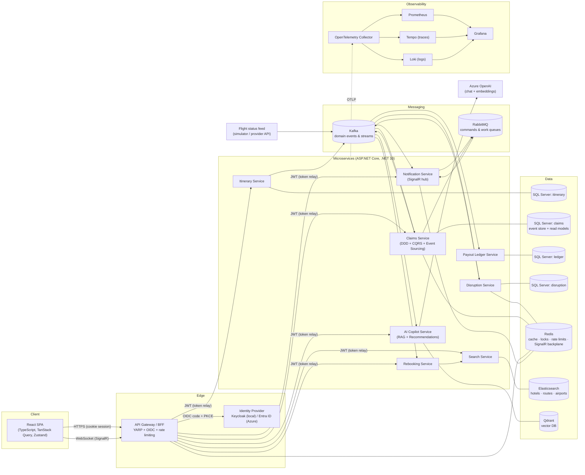
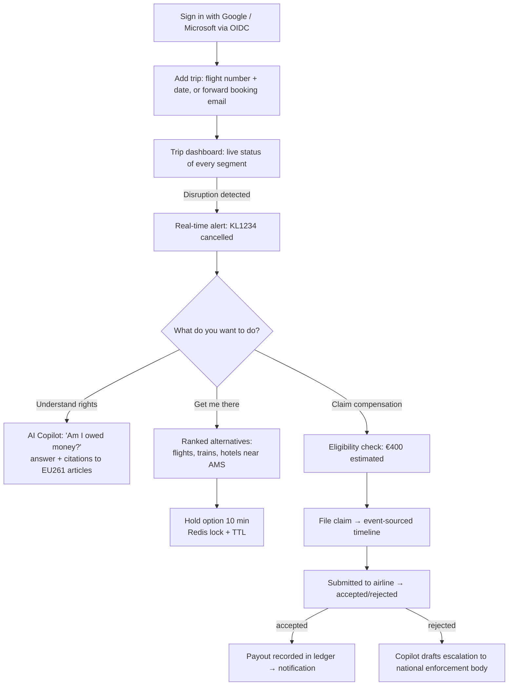

# Part 2 — High-Level Architecture, Communication & User Flow

## 2.1 High-level architecture



### Architecture decisions (and why)

| Decision | Alternatives considered | Why this choice |
|---|---|---|
| **Microservices split by bounded context** (not by entity) | Modular monolith | A modular monolith is honestly the right call for a 1-person *product*. But the goal is to demonstrate distributed-systems skills, so we split where the **domain** has natural seams (different consistency, scaling and change-rate profiles). We keep the count to 8 and document that a modular monolith would be step 1 in a real startup (ADR-001). |
| **API Gateway as BFF (YARP)** | SPA holds tokens; Azure APIM; Ocelot | IETF *OAuth 2.0 for Browser-Based Apps* recommends a BFF: tokens stay server-side, the browser only holds an `HttpOnly; Secure; SameSite=Lax` cookie → no token theft via XSS. YARP is Microsoft's high-performance .NET proxy (used in Azure App Service internally). APIM can still sit in front in Azure for API products/quotas. |
| **Kafka for events, RabbitMQ for commands** | Only Kafka / only RabbitMQ | Different semantics: Kafka = durable, ordered (per key), replayable log, many consumer groups → perfect for *facts* ("FlightCancelled"). RabbitMQ = per-message ack, routing, retries, DLQ, priorities, TTL → perfect for *jobs* ("send this email"). See ADR-002. |
| **Database per service** | Shared DB | Shared schemas couple deploys and teams. Each service owns its data; others get it via events (local read models) or APIs. |
| **SQL Server everywhere for OLTP** | Postgres, Cosmos DB | You already know SQL Server + Dapper — leverage strength, go deep (event store, outbox, indexing) instead of shallow on 3 DBs. Azure SQL is the natural cloud target. |
| **Redis** | In-memory only | Shared cache across replicas, distributed locks (rebooking holds), rate limiter counters, SignalR backplane — one tool, four distributed-systems patterns. |
| **Elasticsearch for search, Qdrant for RAG vectors** | ES only (it has kNN); Azure AI Search | ES excels at BM25 + geo + aggregations for the product search. RAG corpora have a different lifecycle (re-embedding on model change, chunk metadata, tenant filters). Qdrant demonstrates a dedicated vector DB and runs anywhere. ADR-004 notes that collapsing into ES is a valid cost optimisation. |
| **OpenTelemetry → Collector → Prometheus/Tempo/Loki → Grafana** | Vendor SDKs (App Insights only) | Vendor-neutral; Azure Monitor can be added as one more exporter on the Collector without touching code. |

## 2.2 Service communication flow

Three communication styles, each chosen deliberately:

| Style | Used for | Technology | Example |
|---|---|---|---|
| **Synchronous request/response** | Queries the user is waiting for | HTTP/JSON via gateway; HTTP + Polly resilience between services | SPA → Gateway → Claims `GET /api/claims/{id}` |
| **Asynchronous events (pub/sub, log)** | Facts other contexts react to | Kafka (Event Hubs in Azure) | `disruption.detected.v1` consumed by Notification, Claims, Rebooking, Copilot |
| **Asynchronous commands (point-to-point)** | Work that must happen exactly once-ish, with retries | RabbitMQ via MassTransit (Service Bus in Azure) | `SendNotification`, `GenerateClaimLetter` |
| **Server push** | Real-time UI | SignalR (WebSocket) with Redis backplane | "Your KL1234 is cancelled" toast |

### The critical path: disruption → traveller (sequence)

```mermaid
sequenceDiagram
    autonumber
    participant Feed as Flight feed
    participant K as Kafka
    participant D as Disruption Svc
    participant R as Redis
    participant N as Notification Svc
    participant MQ as RabbitMQ
    participant GW as Gateway
    participant UI as React SPA
    participant C as Claims Svc

    Feed->>K: flight-status.raw.v1 (key = flightId)
    K->>D: consume (consumer group: disruption-detector)
    D->>R: HGETALL flight:{id} (previous state)
    D->>D: detect transition (e.g. Scheduled → Cancelled)
    D->>R: HSET flight:{id} new state (Lua, atomic compare)
    D->>K: disruption.detected.v1 (idempotent producer; Redis CAS makes replays safe)
    par fan-out by consumer groups
        K->>N: notification group
        N->>MQ: SendNotification (per affected traveller)
        MQ->>N: worker consumes (retry 3x, then DLQ)
        N->>GW: SignalR message (Redis backplane)
        GW->>UI: WebSocket push → toast
    and
        K->>C: claims group → pre-assess eligibility, cache result
    end
    UI->>GW: POST /api/claims (Idempotency-Key)
    GW->>C: JWT relayed
    C->>C: FileClaim command → aggregate → events appended (optimistic concurrency)
    C-->>UI: 201 Created + Location
```

**Ordering & idempotency guarantees**
- Kafka messages are keyed by `flightId` → all updates for one flight land in one partition → processed in order.
- Producers are **idempotent** (`enable.idempotence=true`, `acks=all`).
- Consumers commit offsets **after** processing and dedupe via an **inbox** (processed message IDs) → effectively-once processing.
- Publishing uses the **transactional outbox**: the business write and the outgoing event are one SQL transaction; a background publisher ships it. No dual-write bug.

### Failure handling matrix

| Failure | Behaviour |
|---|---|
| Claims DB down | Gateway returns 503 via circuit breaker; Kafka consumers pause (no offset commit) → no data loss. |
| Kafka unavailable | Outbox rows accumulate; publisher retries with exponential backoff + jitter; alert on outbox age > 60 s. |
| Email provider down | RabbitMQ retry policy (1 s, 5 s, 30 s), then DLQ; dashboard + replay tool. |
| Azure OpenAI throttled (429) | `Microsoft.Extensions.Http.Resilience` retry honouring `Retry-After`, then graceful "copilot busy" fallback with static rights summary. |
| Poison message | Max delivery attempts → dead-letter topic `*.dlq` with error headers. |
| Duplicate HTTP POST (user double-click, network retry) | `Idempotency-Key` header stored in Redis (24 h) → same response replayed. |

## 2.3 User flow



### Key screens
1. **Trips dashboard** — segments with live status chips (SignalR).
2. **Disruption detail** — what happened, your rights, alternatives, "File claim" CTA.
3. **Claim detail** — status + **event timeline** (straight from the event store — great demo of event sourcing).
4. **Copilot drawer** — streaming answers with citations.
5. **Admin/ops** (role `ops`) — DLQ viewer, outbox lag, RAG ingestion.

Next: [Part 3 — Microservices](03-microservices.md)
