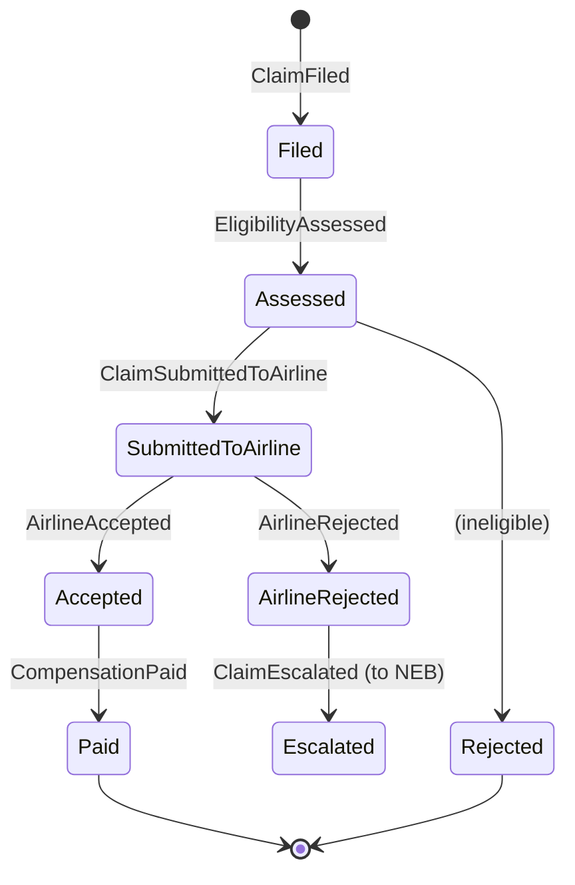

# Part 3 — Microservices Breakdown

Rule of thumb used throughout: **architecture weight follows domain complexity.** Claims has rich rules → full Clean Architecture (4 projects). Notification is a thin adapter → a single project with folders. Over-engineering a CRUD-ish service is as much a red flag in a Staff interview as under-engineering a complex one.

| # | Service | Bounded context | Style | Datastore(s) | Publishes | Consumes | Build phase |
|---|---|---|---|---|---|---|---|
| 0 | **Gateway (BFF)** | Edge | YARP | Redis (sessions, rate limits) | — | — | 1 |
| 1 | **Itinerary** | Trips & segments | Clean Arch, CRUD-ish + events | SQL Server `itinerary` | `itinerary.events.v1` | — | 2 |
| 2 | **Disruption** | Flight state & disruption detection | Stream processor | SQL Server `disruption`, Redis | `disruption.detected.v1` | `flight-status.raw.v1`, `itinerary.events.v1` | 2 |
| 3 | **Claims** ⭐ | EU261 claims | **DDD + CQRS + Event Sourcing** | SQL Server `claims` (event store, read models, outbox, inbox), Redis | `claims.events.v1`, RabbitMQ commands | `disruption.detected.v1` | **1 (reference)** |
| 4 | **Payout Ledger** | Money movement | Double-entry ledger | SQL Server `ledger` | `ledger.events.v1` | `claims.events.v1` | 3 |
| 5 | **Rebooking** | Alternatives & holds | Orchestrator | Redis (holds/locks) | `rebooking.events.v1` | `disruption.detected.v1` | 3 |
| 6 | **Search** | Hotels, airports, routes | Read-optimised | Elasticsearch | — | `catalog.*` | 2 |
| 7 | **AI Copilot** | RAG, recommendations | Pipeline | Qdrant, Redis (semantic cache) | — | `disruption.detected.v1` | 3 |
| 8 | **Notification** | Delivery channels | Worker + SignalR hub | Redis (backplane), SQL `notification` (delivery log) | — | Kafka + RabbitMQ | 2 |

---

## 3.0 Gateway / BFF
**Responsibilities**
- OIDC Authorization Code + PKCE login with the IdP; stores tokens server-side; issues an encrypted `HttpOnly` session cookie.
- **Token relay**: attaches the user's access token (`Authorization: Bearer …`) to proxied calls → downstream services stay stateless JWT resource servers.
- Routing (`/api/claims/**` → claims, …), WebSocket proxying for SignalR.
- Cross-cutting: rate limiting (token bucket per user, sliding window per IP), CORS (dev only), request size limits, correlation ID, OTel root span.
- Anti-forgery: requires custom header `X-CSRF: 1` on state-changing requests (SameSite + custom header defence).

**Why not let each service handle login?** Single place to change auth; services never see cookies; consistent security headers.

## 3.1 Itinerary Service
- Aggregate **Trip** (id, ownerId, name) containing **Segments** (FlightSegment, TrainSegment, HotelStay) — invariant: segments must not overlap in time.
- Commands: `CreateTrip`, `AddFlightSegment`, `RemoveSegment`, `ImportFromEmail` (phase 4, AI extraction).
- Publishes `SegmentAdded` / `SegmentRemoved` → Disruption service builds its **local read model** of "which travellers are on flight X on date D". This avoids a synchronous call on the hot path (a key distributed-systems point: *data locality over chatty RPC*).
- DB: `itinerary` — Trips, Segments, Outbox.

## 3.2 Disruption Service
- Consumes the raw flight status firehose (`flight-status.raw.v1`, key = `{carrier}{number}:{date}`).
- Keeps **latest known state per flight in Redis** (hash) — sub-millisecond reads; SQL is the durable history.
- Detects transitions: `Delayed ≥ 180 min`, `Cancelled`, `Diverted`, `GateChange` (informational).
- Uses an atomic Lua script for compare-and-set so two replicas processing a rebalanced partition can't double-emit.
- Joins disruption with its **affected-travellers read model** and publishes `disruption.detected.v1` with the list of affected traveller IDs.
- In dev, a `FlightStatusSimulator` produces realistic random traffic (configurable RPS) → doubles as a load generator.
- DB: `disruption` — FlightStatusHistory (append-only), AffectedTravellers (read model), Outbox, Inbox.

## 3.3 Claims Service ⭐ (reference implementation)
- Aggregate **Claim** (event-sourced). Lifecycle:

- **Domain service `Eu261CompensationPolicy`** — pure function: distance band (€250 / €400 / €600), arrival-delay threshold (≥3 h), cancellation notice (<14 days), extraordinary-circumstances exemption, 50 % reduction when rerouting kept delay under 2/3/4 h. Exhaustively unit-tested with table-driven tests.
- **CQRS**: write side = event store; read side = `ClaimSummaries` table (Dapper queries), updated by an inline projection in the same transaction (read-your-writes for the UI), plus asynchronous projections downstream via Kafka.
- Commands: `FileClaim`, `SubmitClaimToAirline`, `RecordAirlineDecision`, `EscalateClaim`, `MarkCompensationPaid`.
- Queries: `GetClaim`, `ListMyClaims`, `GetClaimTimeline` (replays events — the audit trail).
- Publishes integration events (`ClaimAccepted` → Ledger) via the outbox; sends RabbitMQ commands (`GenerateClaimLetter`).
- DB: `claims` — Events, Snapshots, ClaimSummaries, Outbox, Inbox, SchemaVersions.

## 3.4 Payout Ledger Service
- **Double-entry bookkeeping**: every payout is a `JournalEntry` with ≥2 `Postings` summing to zero (e.g. *Airline receivable* −400, *Traveller payable* +400).
- **Idempotency**: unique constraint on `(SourceSystem, SourceReference)` → re-delivered `ClaimAccepted` events cannot double-pay.
- Balances computed from postings (append-only); materialised balance table updated in the same transaction with row-versioning.
- This is the single most Adyen/ING-relevant component. Keep it small but *correct*.

## 3.5 Rebooking Service
- On disruption: fetch alternatives (Search service for hotels; provider adapters for flights/trains — mocked).
- **Holds**: `SET hold:{optionId} {travellerId} NX PX 600000` → only one traveller can hold the last seat; expires automatically.
- Calls Copilot's recommendation endpoint to rank options per traveller.
- Saga (orchestration) for "rebook + cancel original + update itinerary" with compensating actions — documented as a phase-3 stretch.

## 3.6 Search Service
- Elasticsearch indices: `hotels` (geo_point, amenities, price, `dense_vector` description embedding), `airports` (completion suggester), `routes`.
- Endpoints: `GET /api/search/hotels?airport=AMS&radiusKm=10&q=quiet+with+gym`, `GET /api/search/airports/suggest?prefix=ams`.
- Hybrid ranking: BM25 + geo distance decay + kNN on embeddings (Reciprocal Rank Fusion).
- Index aliases (`hotels` → `hotels_v3`) for zero-downtime reindex.

## 3.7 AI Copilot Service
- **RAG** over: EU261 text, airline Conditions of Carriage, national enforcement body guidance, and the user's own trip/claim (fetched on-the-fly, never embedded → no PII in the vector store).
- **Recommendation engine** ranking rebooking alternatives (see Part 8).
- Streams answers via Server-Sent Events; returns citations.
- Semantic cache in Redis (same question + same context hash → cached answer) to cut cost.

## 3.8 Notification Service
- Kafka consumer (`disruption.detected.v1`, `claims.events.v1`) → translates facts into per-recipient **commands** on RabbitMQ (`SendNotification`).
- RabbitMQ consumers per channel (email via SMTP/Mailpit locally, Azure Communication Services in cloud; web push; SignalR).
- SignalR hub `/hubs/notifications`, user-targeted via `sub` claim, Redis backplane for multi-replica fan-out.
- Delivery log for idempotency + user preferences (quiet hours, channels).

---

## Database-per-service summary

| Service | Engine | Why |
|---|---|---|
| Itinerary | Azure SQL | Relational, transactional, small. |
| Disruption | Azure SQL + Redis | Durable history + hot state. |
| Claims | Azure SQL (event store) | Append-only table with unique `(StreamId, Version)` gives optimistic concurrency for free; you already know SQL Server deeply. |
| Ledger | Azure SQL | ACID is non-negotiable for money. |
| Rebooking | Redis | Ephemeral holds with TTL. |
| Search | Elasticsearch | Full-text, geo, aggregations. |
| Copilot | Qdrant (+ Redis) | Vector similarity with payload filters. |
| Notification | Azure SQL + Redis | Delivery log + backplane. |

Next: [Part 4 — Frontend](04-frontend.md)
