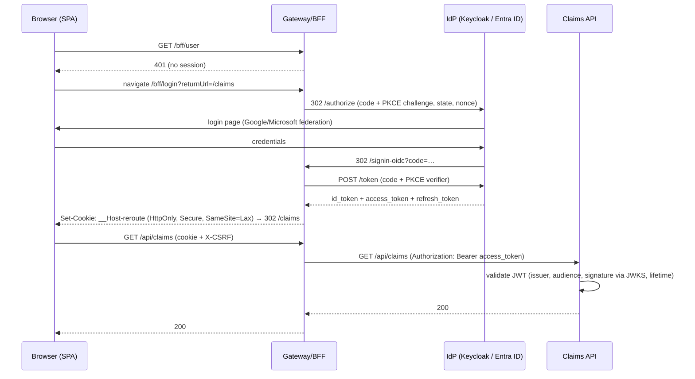

# Part 4 — React Frontend Architecture

**Stack:** React 19 · TypeScript 5 (strict) · Vite · TanStack Query v5 (server state) · Zustand (client state) · React Router v7 · Zod (runtime validation) · `@microsoft/signalr` · Vitest + Testing Library + MSW · Playwright.

## 4.1 Architectural principles

| Principle | Implementation | Why |
|---|---|---|
| **Feature-sliced structure** | `src/features/<feature>/{api,components,hooks,model}` | Code that changes together lives together; features can be lazy-loaded and owned independently (how Booking.com-scale frontends stay sane). |
| **Server state ≠ client state** | TanStack Query for anything from the API; Zustand only for UI state (drawer open, theme) | 90 % of "Redux state" in typical apps is a stale server cache. Query gives caching, dedupe, retries, background refetch, optimistic updates. |
| **Trust nothing at the boundary** | Zod schemas parse every API response | TypeScript types vanish at runtime; Zod catches backend contract drift immediately (with a clear error instead of `undefined is not a function` three components later). |
| **Typed API contract** | OpenAPI → generated types (`openapi-typescript`) in CI; Zod schemas for critical paths | Contract drift breaks the build, not production. |
| **Dependency direction** | `app → features → shared`; features never import each other directly (ESLint `import/no-restricted-paths`) | Prevents a big ball of mud. |
| **Real-time as cache updates** | SignalR events call `queryClient.setQueryData` / `invalidateQueries` | One source of truth; components don't care whether data came from HTTP or WebSocket. |
| **Code splitting** | Route-level `lazy()` | Fast first paint — Core Web Vitals matter at Booking.com. |
| **Accessibility** | Semantic HTML, focus management, `aria-live` for disruption toasts | Real product quality signal. |

## 4.2 Folder structure

```
web/
├── index.html
├── package.json
├── vite.config.ts               # dev proxy /api,/bff,/hubs → gateway:8080
├── tsconfig.json                # strict, noUncheckedIndexedAccess, exactOptionalPropertyTypes
├── playwright.config.ts
├── e2e/
│   └── claim-flow.spec.ts
└── src/
    ├── main.tsx                 # bootstraps providers
    ├── app/
    │   ├── App.tsx
    │   ├── providers.tsx        # QueryClientProvider, AuthProvider, RealtimeProvider
    │   ├── router.tsx           # route tree, lazy routes, auth guard
    │   └── layout/AppShell.tsx
    ├── shared/
    │   ├── api/
    │   │   ├── httpClient.ts    # fetch wrapper: CSRF header, problem+json, correlation id
    │   │   ├── errors.ts        # ApiError, ProblemDetails parsing
    │   │   └── queryClient.ts   # retry policy, staleTime defaults
    │   ├── auth/
    │   │   ├── AuthProvider.tsx # GET /bff/user, login/logout redirects
    │   │   └── RequireAuth.tsx
    │   ├── realtime/
    │   │   └── RealtimeProvider.tsx  # SignalR connection, reconnect, → query cache
    │   ├── store/uiStore.ts     # Zustand: copilot drawer, toasts
    │   ├── lib/                 # formatters (money, dates), idempotency key helper
    │   └── ui/                  # design-system primitives (Button, Card, Badge, Timeline)
    ├── features/
    │   ├── trips/               # dashboard, segment status chips
    │   ├── disruptions/         # disruption detail, alternatives list
    │   ├── claims/
    │   │   ├── api/claimsApi.ts       # endpoints + Zod schemas
    │   │   ├── api/queryKeys.ts       # key factory
    │   │   ├── hooks/useClaims.ts     # useClaim, useMyClaims, useFileClaim (optimistic)
    │   │   ├── components/ClaimTimeline.tsx
    │   │   ├── components/FileClaimForm.tsx
    │   │   ├── pages/ClaimsPage.tsx
    │   │   └── pages/ClaimDetailPage.tsx
    │   ├── copilot/             # streaming chat drawer (SSE), citations
    │   └── search/              # hotel search near airport
    └── test/
        ├── setup.ts             # MSW server, jest-dom
        └── handlers.ts          # MSW API mocks
```

## 4.3 State management

| State kind | Tool | Example |
|---|---|---|
| Server cache | TanStack Query | claims list, claim detail, trips |
| Real-time server events | SignalR → Query cache | `ClaimStatusChanged` → `setQueryData(claimKeys.detail(id))` |
| Global UI state | Zustand (tiny, no boilerplate) | copilot drawer open, toast queue |
| URL state | React Router search params | filters (`?status=Submitted`), pagination — shareable links |
| Form state | Native form + Zod validation (or React Hook Form if forms grow) | file-claim form |
| Auth/session | React context backed by `/bff/user` query | user name, roles |

**Query key factory** (prevents typo-driven cache bugs):
```ts
export const claimKeys = {
  all: ['claims'] as const,
  lists: () => [...claimKeys.all, 'list'] as const,
  list: (filters: ClaimFilters) => [...claimKeys.lists(), filters] as const,
  detail: (id: string) => [...claimKeys.all, 'detail', id] as const,
  timeline: (id: string) => [...claimKeys.detail(id), 'timeline'] as const,
};
```

## 4.4 API layer

`shared/api/httpClient.ts` responsibilities:
1. Prefix `/api`, send cookies (`credentials: 'include'`).
2. Add `X-CSRF: 1` on every request (BFF requires it for non-GET).
3. Add `Idempotency-Key` for POSTs that create resources (generated once per form submission, reused across retries).
4. Parse `application/problem+json` into a typed `ApiError` (status, title, field errors) — UI shows field-level errors from FluentValidation.
5. Parse the body with the supplied Zod schema → typed result or contract error.
6. On `401`, redirect to `/bff/login?returnUrl=…`.

Copilot streaming uses `fetch` + `ReadableStream` to read Server-Sent Events (works through the BFF cookie, unlike `EventSource` with custom headers).

## 4.5 Authentication flow (BFF pattern)



**Why BFF instead of tokens in the SPA?** XSS in a SPA with tokens in `localStorage` = account takeover. With a BFF, JavaScript can never read a token. This is the current IETF best practice and a great interview talking point.

## 4.6 Testing
- **Unit/component**: Vitest + Testing Library, MSW to mock the network at the fetch level (tests don't know about the HTTP client implementation).
- **E2E**: Playwright against the docker-compose stack (login with a Keycloak test user, simulate disruption, file claim, assert timeline).
- **Visual/accessibility**: `@axe-core/playwright` in E2E.

Next: [Part 5 — Backend](05-backend.md)
