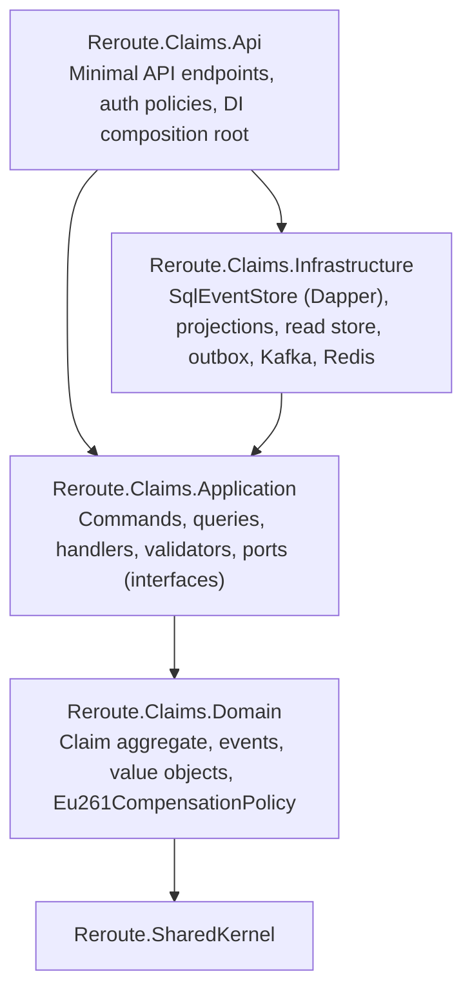

# Part 5 — Backend Architecture (ASP.NET Core / .NET 10)

## 5.1 Solution layout

```
src/
├── BuildingBlocks/
│   ├── Reroute.SharedKernel/        # DDD primitives — ZERO infrastructure dependencies
│   │   ├── Entity.cs, AggregateRoot.cs, EventSourcedAggregate.cs
│   │   ├── IDomainEvent.cs, Result.cs, Error.cs
│   └── Reroute.BuildingBlocks/      # reusable infrastructure
│       ├── Cqrs/                    # ICommand, IQuery, handlers, Dispatcher, decorators
│       ├── Messaging/               # Kafka producer/consumer base, Outbox, Inbox, IntegrationEvent
│       ├── Persistence/             # SqlConnectionFactory, SqlMigrator
│       ├── Web/                     # ProblemDetails mapping, Idempotency filter, auth setup
│       └── Observability/           # OpenTelemetry setup (traces, metrics, logs)
├── Gateway/Reroute.Gateway/         # YARP BFF
└── Services/
    ├── Claims/                      # ⭐ full Clean Architecture
    │   ├── Reroute.Claims.Domain/
    │   ├── Reroute.Claims.Application/
    │   ├── Reroute.Claims.Infrastructure/
    │   └── Reroute.Claims.Api/
    ├── Disruption/Reroute.Disruption.Api/      # stream processor (single project)
    ├── Notification/Reroute.Notification.Api/  # worker + SignalR (single project)
    ├── Copilot/Reroute.Copilot.Api/            # RAG pipeline (single project)
    └── Search/Reroute.Search.Api/              # Elasticsearch (single project)
tests/
├── Reroute.Claims.UnitTests/
├── Reroute.Claims.IntegrationTests/            # Testcontainers (SQL Server)
└── Reroute.ArchitectureTests/                  # enforce dependency rules
```

**Central Package Management** (`Directory.Packages.props`) pins every NuGet version in one place; `Directory.Build.props` turns on nullable, warnings-as-errors, analyzers. Staff-level hygiene that reviewers notice.

### Licensing awareness (an underrated senior signal)
- **MediatR** (v13+) and **MassTransit** (v9+) moved to commercial licences in 2025. We implement a ~100-line CQRS dispatcher ourselves (demonstrates understanding) and pin **MassTransit 8.x** (Apache-2.0).
- **FluentAssertions** v8 is commercial → we use **Shouldly**.
- Say this in an interview: it shows you think about supply chain and cost, not just code.

## 5.2 Clean Architecture / DDD layers (Claims)



| Layer | Contains | Must NOT contain | Enforced by |
|---|---|---|---|
| Domain | Aggregates, value objects (C# `record`s), domain events, domain services, invariants | EF/Dapper, HTTP, logging, `DateTime.Now` (use `TimeProvider`) | ArchitectureTests (NetArchTest-style reflection) |
| Application | Use cases (handlers), ports (`IClaimRepository`, `IClaimReadStore`, `IAirportDirectory`), validators, DTOs | SQL, Kafka types | ArchitectureTests |
| Infrastructure | Adapters implementing ports | Business rules | Code review |
| Api | Endpoints, DI, auth, OpenAPI | Business rules | Code review |

## 5.3 CQRS structure

```
Application/
├── Abstractions/        IClaimRepository, IClaimReadStore, IAirportDirectory, ICurrentUser
├── Claims/
│   ├── FileClaim/       FileClaimCommand.cs, FileClaimHandler.cs, FileClaimValidator.cs
│   ├── SubmitClaim/     ...
│   ├── RecordAirlineDecision/
│   ├── GetClaim/        GetClaimQuery.cs, GetClaimHandler.cs, ClaimDto.cs
│   ├── ListMyClaims/
│   └── GetClaimTimeline/
```

**Pipeline (decorators around every handler):**
`TracingBehavior → ValidationBehavior → Handler`
- Tracing: opens an `Activity` named after the command, records outcome — every command shows up in Tempo.
- Validation: runs FluentValidation validators, short-circuits with `Result.Failure(Error.Validation(...))` → endpoint maps to `400 problem+json`.

**Write side**: command → load aggregate from event store → call domain method → append new events (optimistic concurrency) + inline projection + outbox — **one SQL transaction**.

**Read side**: query → Dapper `SELECT` on denormalised `ClaimSummaries` (no joins, covering index) → cached via `HybridCache` (L1 in-memory + L2 Redis, tag-based invalidation).

**Why separate read/write models here?** The write model is an event stream (great for audit, terrible for "list my claims sorted by date"). The read model is a flat table optimised for the UI. That tension is exactly the problem CQRS solves — it isn't added for fashion.

## 5.4 Repository pattern
- **One repository per aggregate**, not per table: `IClaimRepository { Task<Claim?> GetAsync(ClaimId); Task SaveAsync(Claim, CancellationToken) }`.
- No generic `IRepository<T>` with `GetAll()` — it leaks query concerns into the domain and encourages N+1. Queries go through the read store instead.
- Implementation `EventSourcedClaimRepository` reads/writes the event stream through `IEventStore`.

## 5.5 Event sourcing (Claims)

**Why event sourcing *here* (and only here)?**
- Claims are legal/financial processes: "who changed what, when, and why" is a product feature (timeline UI) and a compliance requirement.
- Disputes with airlines need the historical state *at the time of submission* — temporal queries come for free.
- New read models (e.g. "average airline response time") can be built by replaying history.

**Store design (SQL Server):**
```sql
CREATE TABLE claims.Events (
  GlobalPosition BIGINT IDENTITY PRIMARY KEY,
  StreamId       UNIQUEIDENTIFIER NOT NULL,
  StreamVersion  INT              NOT NULL,
  EventType      NVARCHAR(200)    NOT NULL,
  Data           NVARCHAR(MAX)    NOT NULL,  -- JSON
  Metadata       NVARCHAR(MAX)    NOT NULL,  -- correlationId, causationId, userId, traceparent
  OccurredAt     DATETIME2(3)     NOT NULL,
  CONSTRAINT UQ_Events_Stream UNIQUE (StreamId, StreamVersion)  -- optimistic concurrency
);
```
- Append = `INSERT` rows with `expectedVersion + 1..n`. A concurrent writer violates `UQ_Events_Stream` (error 2627) → `ConcurrencyException` → endpoint returns `409 Conflict`; client refetches.
- **Snapshots** every 50 events (claims rarely exceed 10; implemented to show the concept, configurable).
- **Event versioning**: events are immutable contracts. Upcasters translate `ClaimFiled.v1` → `v2` on read. Never rename an event type.
- **GDPR**: personal data is *not* stored in events — events hold `TravellerId` only; PII lives in a separate deletable table (crypto-shredding is the stretch approach). This is a classic event-sourcing interview question.

```csharp
// Domain: state changes ONLY through events
public Result FileClaim(...)  // command method validates invariants
{
    Raise(new ClaimFiled(...));    // records + applies
}
protected override void When(IDomainEvent e)   // pure state transition
{
    switch (e) { case ClaimFiled f: Status = ClaimStatus.Filed; ... }
}
```

## 5.6 API design
- Minimal APIs grouped per feature (`app.MapGroup("/api/claims").RequireAuthorization()`), OpenAPI via `Microsoft.AspNetCore.OpenApi` + Scalar UI.
- **Problem Details (RFC 9457)** for every error.
- **Idempotency-Key** filter on POSTs (Redis, 24 h).
- Versioning by URL segment only when a breaking change happens (`/api/v2/...`) — YAGNI until then.
- `ETag` / `If-Match` on mutating claim endpoints maps to the stream version → HTTP-level optimistic concurrency.

## 5.7 Authorization model
| Policy | Rule | Used by |
|---|---|---|
| `traveller` | authenticated, scope `reroute.api` | own trips/claims |
| `ops` | role `ops` | DLQ replay, airline decision recording |
| Resource-based | `claim.TravellerId == user.sub` | every claim read/write (checked in handler via `ICurrentUser`) → prevents IDOR |

## 5.8 Resilience between services
`Microsoft.Extensions.Http.Resilience` standard pipeline: timeout → retry (exponential + jitter, only idempotent verbs) → circuit breaker → total timeout. Configured once in BuildingBlocks.

Next: [Part 6 — Database](06-database.md)
