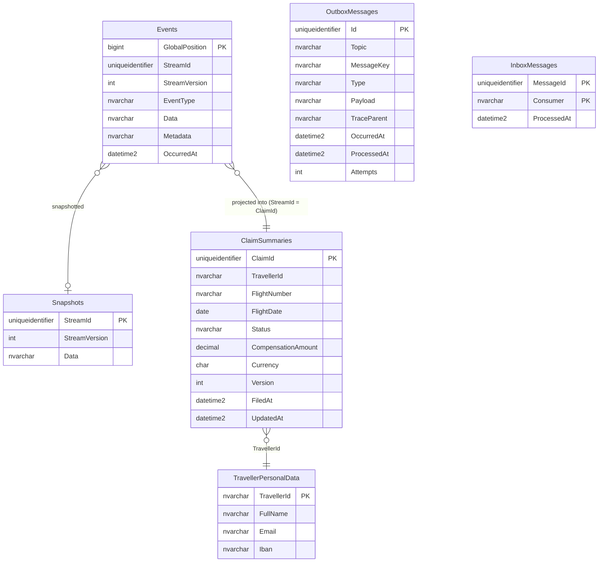
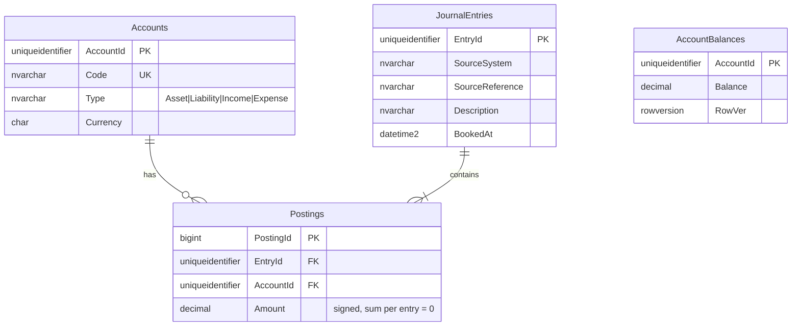

# Part 6 — Database Design

Each service owns a database (in Azure: separate databases in one **Azure SQL Elastic Pool** to keep cost low while preserving isolation). Schemas use a service-named SQL schema (`claims.`, `ledger.` …) so a later consolidation is painless.

## 6.1 Claims (`claims` DB) — event store + read models



Full DDL: [`src/Services/Claims/Reroute.Claims.Infrastructure/Persistence/Migrations/0001_initial.sql`](../src/Services/Claims/Reroute.Claims.Infrastructure/Persistence/Migrations/0001_initial.sql)

### Indexing strategy (Claims)

| Index | Type | Serves | Reasoning |
|---|---|---|---|
| `PK_Events (GlobalPosition)` | Clustered, ever-increasing BIGINT | Projections reading "all events after position N" | Sequential inserts → no page splits, ideal for append-only. |
| `UQ_Events_Stream (StreamId, StreamVersion)` | Unique nonclustered | Load a stream in order; **optimistic concurrency** | Doubles as the concurrency guard — the DB enforces it, not the app. |
| `PK_ClaimSummaries (ClaimId)` | Clustered | Detail lookup | GUIDs → use `NEWSEQUENTIALID()`-like v7 GUIDs (`Guid.CreateVersion7()` in .NET 9+) to avoid fragmentation. |
| `IX_ClaimSummaries_Traveller (TravellerId, FiledAt DESC) INCLUDE (Status, FlightNumber, FlightDate, CompensationAmount, Currency)` | Covering | "My claims" page, newest first | Single index seek, zero key lookups. |
| `IX_ClaimSummaries_Status (Status, UpdatedAt) WHERE Status IN ('SubmittedToAirline','Escalated')` | **Filtered** | Ops queue of claims waiting on airlines | Tiny index — only active claims. |
| `IX_Outbox_Unprocessed (OccurredAt) WHERE ProcessedAt IS NULL` | Filtered | Outbox publisher polling | Stays small forever; processed rows are excluded. |
| `PK_Inbox (MessageId, Consumer)` | Clustered | Idempotent consumer check | Insert-or-fail = dedupe. |

## 6.2 Ledger (`ledger` DB) — double-entry



- `UQ_JournalEntries_Source (SourceSystem, SourceReference)` → **idempotent payouts**.
- Zero-sum invariant enforced in the domain *and* by a check in the posting stored procedure (`THROW` if `SUM(Amount) <> 0`).
- `DECIMAL(19,4)` for money — never `float`. Currency per account; no cross-currency postings without an FX entry.
- `IX_Postings_Account (AccountId, PostingId) INCLUDE (Amount)` → account statement queries.

## 6.3 Itinerary (`itinerary` DB)

```sql
CREATE TABLE itinerary.Trips (
  TripId UNIQUEIDENTIFIER PRIMARY KEY, OwnerId NVARCHAR(64) NOT NULL,
  Name NVARCHAR(200) NOT NULL, CreatedAt DATETIME2(3) NOT NULL, RowVer ROWVERSION);
CREATE TABLE itinerary.Segments (
  SegmentId UNIQUEIDENTIFIER PRIMARY KEY,
  TripId UNIQUEIDENTIFIER NOT NULL REFERENCES itinerary.Trips(TripId) ON DELETE CASCADE,
  Kind VARCHAR(10) NOT NULL CHECK (Kind IN ('Flight','Train','Hotel')),
  CarrierCode VARCHAR(3) NULL, ServiceNumber VARCHAR(8) NULL,   -- KL + 1234
  Origin CHAR(3) NULL, Destination CHAR(3) NULL,
  StartsAt DATETIMEOFFSET NOT NULL, EndsAt DATETIMEOFFSET NOT NULL,
  BookingReference NVARCHAR(20) NULL);
CREATE INDEX IX_Segments_Trip ON itinerary.Segments(TripId, StartsAt);
CREATE INDEX IX_Segments_Service ON itinerary.Segments(CarrierCode, ServiceNumber, StartsAt) WHERE Kind = 'Flight';
```

## 6.4 Disruption (`disruption` DB)

```sql
CREATE TABLE disruption.FlightStatusHistory (
  Id BIGINT IDENTITY PRIMARY KEY, FlightKey VARCHAR(32) NOT NULL,   -- KL1234:2026-11-09
  Status VARCHAR(16) NOT NULL, DelayMinutes INT NOT NULL, Reason NVARCHAR(200) NULL,
  ReceivedAt DATETIME2(3) NOT NULL)
  WITH (DATA_COMPRESSION = PAGE);                                   -- high-volume, append-only
CREATE INDEX IX_History_Flight ON disruption.FlightStatusHistory(FlightKey, ReceivedAt DESC);

CREATE TABLE disruption.AffectedTravellers (   -- local read model built from itinerary events
  FlightKey VARCHAR(32) NOT NULL, TravellerId NVARCHAR(64) NOT NULL, SegmentId UNIQUEIDENTIFIER NOT NULL,
  CONSTRAINT PK_Affected PRIMARY KEY (FlightKey, TravellerId, SegmentId));
```
At real scale `FlightStatusHistory` is partitioned by month (partition function on `ReceivedAt`) with a sliding-window retention job — mention in interviews; not needed for the demo.

## 6.5 Cross-cutting database rules
1. **Migrations as plain, idempotent SQL scripts** applied by a small migrator (`SqlMigrator`) tracking `dbo.SchemaVersions`. In CI they run against a Testcontainers SQL Server; in Azure they run as a Kubernetes **Job** before rollout (not on app start → no race between replicas).
2. **No cross-database joins / foreign keys** — boundaries are enforced by physical separation.
3. **`READ_COMMITTED_SNAPSHOT ON`** for every DB → readers don't block writers.
4. **Least privilege**: each service uses an Entra ID managed identity mapped to a DB user with only `db_datareader`, `db_datawriter`, and `EXECUTE` — no `db_owner` in production.

Next: [Part 7 — Redis, Kafka, RabbitMQ](07-messaging-caching.md)
