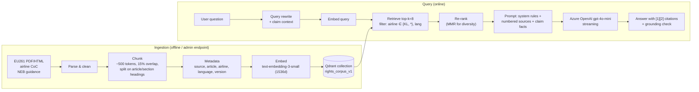

# Part 8 — AI Features

All AI code uses **`Microsoft.Extensions.AI`** abstractions (`IChatClient`, `IEmbeddingGenerator`). Locally they bind to OpenAI (or Ollama for zero cost); in Azure to **Azure OpenAI** with managed identity. Swapping providers is a DI change — the same principle as MassTransit's transport swap.

## 8.1 Features

| Feature | Technique | User value |
|---|---|---|
| **Rights Copilot** | RAG over EU261 + airline Conditions of Carriage + NEB guidance, grounded in the user's own claim | "Am I owed money for KL1234?" → precise answer with article citations |
| **Semantic search** | Embeddings in Elasticsearch (`dense_vector`) + BM25 hybrid | "Quiet hotel near Schiphol with a gym and late check-in" |
| **Recommendation engine** | Hybrid: content-based (embedding similarity to preference profile) + rules + learned weights | Best rebooking alternative ranked first |
| **Booking email extraction** (phase 4) | Structured output (JSON schema) from forwarded confirmation email | Zero-typing trip import |
| **Escalation letter drafting** | Templated generation constrained by claim facts | Rejected claim → ready-to-send complaint |

## 8.2 RAG pipeline



### Design decisions
| Decision | Why |
|---|---|
| **Structure-aware chunking** (split on "Article 7") | Legal text: an article is the semantic unit; fixed-size chunks would split "€400" from its condition. |
| **Metadata filters** in Qdrant (airline, language) | Retrieval precision; prevents KLM questions pulling Ryanair rules. |
| **User data injected at query time, not embedded** | No PII in the vector DB → GDPR erasure is trivial. |
| **Deterministic facts computed by code, not the LLM** | The €-amount comes from `Eu261CompensationPolicy` and is passed to the prompt as a fact. LLMs explain; code calculates. *Huge* interview point. |
| **Citations required** | System prompt requires `[n]` references; post-check rejects answers citing non-existent sources. |
| **Small model + good retrieval** | gpt-4o-mini class model is ~15× cheaper; quality comes from retrieval. |
| **Semantic cache** | Normalised question + context hash → Redis, 24 h. Common questions cost €0. |
| **Collection versioning** (`rights_corpus_v1`) | Changing the embedding model requires re-embedding; alias swap = zero downtime. |

### Prompt-injection & safety
- Retrieved text is wrapped in `<source id="n">…</source>` and the system prompt states sources are *data, not instructions*.
- Output never triggers actions directly; filing a claim always requires a user click.
- Rate limit per user on copilot endpoints; max tokens per request; content filter (Azure OpenAI built-in).

### Evaluation (what makes it "Databricks-grade")
- `tests/rag-eval/questions.jsonl`: 50 Q/A pairs with expected source articles.
- Metrics: **retrieval hit@k**, **answer faithfulness** (LLM-as-judge with a rubric), **citation accuracy**, latency p95, cost per answer.
- Runs nightly in GitHub Actions; results posted as a job summary. Regressions block prompt/model changes.

## 8.3 Embeddings
- Model: `text-embedding-3-small` (1536 dims; cheap, strong). Stored as `float32`; Qdrant scalar quantisation (int8) cuts memory 4× with negligible recall loss.
- Distance: cosine.
- Batching: 64 inputs per request; ingestion is idempotent (point ID = hash(source, chunkIndex, version)).

## 8.4 Semantic search (Search service)
- Hotel descriptions embedded at index time (`dense_vector`, `index: true`, HNSW).
- Query: run BM25 + geo filter and kNN in one request; combine with **Reciprocal Rank Fusion**: `score = Σ 1/(60 + rank_i)`.
- Why hybrid: BM25 nails exact terms ("Hilton", "gym"), vectors nail intent ("quiet", "good for families").

## 8.5 Recommendation engine (ranking rebooking alternatives)

**Score for option *o* and traveller *u*:**
```
score(o,u) = w1·arrivalDelayScore(o)          // earlier arrival = better (dominant)
           + w2·cosine(embed(o), prefProfile(u))  // content-based personalisation
           + w3·priceScore(o)
           + w4·reliabilityScore(o.carrier, route) // historical on-time % from disruption data
           − w5·connectionRisk(o)               // short layovers penalised
```
- `prefProfile(u)` = exponentially-decayed average of embeddings of options the user previously chose (cold start → segment default, e.g. "business traveller").
- Weights start hand-tuned; phase-4 stretch: learn them with logistic regression on click/accept logs (exported from Kafka → Databricks/Spark notebook → weights JSON). That gives you a credible end-to-end **ML-loop** story for Databricks.
- Explainability: the API returns the top contributing factors ("arrives 2h earlier, matches your preference for direct flights").

## 8.6 Cost & observability for AI
- Every LLM call emits OTel spans with `gen_ai.*` semantic-convention attributes (model, input/output tokens) — `Microsoft.Extensions.AI` `UseOpenTelemetry()` does this.
- Grafana panel: tokens/day, € per day, p95 latency, cache hit rate.
- Budget guard: daily token budget in Redis; exceeding → degrade to cached/static answers.

Next: [Part 9 — Docker & Kubernetes](09-containers-k8s.md)
