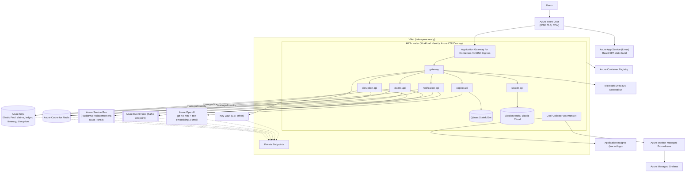

# Part 10 — Azure Deployment Architecture



## 10.1 Service mapping & justification

| Local | Azure | Why |
|---|---|---|
| React (Vite build) | **Azure App Service** (Linux, Node/static) behind Front Door | Requirement; simple deploy slots for blue/green (`staging` slot swap). (Static Web Apps is a cheaper alternative.) |
| Gateway + services | **AKS** | Requirement; showcases K8s skills; HPA, Workload Identity, network policies. |
| SQL Server | **Azure SQL** (Elastic Pool) | Managed backups, PITR, geo-replication; elastic pool shares DTUs across the 4 small DBs (cost). Entra-only auth. |
| Redis | **Azure Cache for Redis** (or Azure Managed Redis) | Managed, TLS, private endpoint. |
| RabbitMQ | **Azure Service Bus** (Standard) | Queues, DLQ, sessions, scheduled delivery; MassTransit transport swap = config change. |
| Kafka | **Azure Event Hubs** (Standard, Kafka endpoint) | Kafka protocol-compatible — `Confluent.Kafka` client unchanged, only bootstrap servers + SASL config. |
| OpenAI | **Azure OpenAI** | Data stays in EU region (Sweden Central / West Europe) → GDPR story; managed identity, content filtering. |
| Keycloak | **Microsoft Entra External ID** | Managed CIAM; Google/Microsoft social login. |
| Secrets | **Key Vault** + CSI driver + Workload Identity | Zero secrets in pipelines or manifests. |
| Prometheus/Grafana | **Azure Monitor managed Prometheus + Azure Managed Grafana** (or self-hosted in AKS) | Same PromQL & dashboards as local. |

## 10.2 Identity & security
- **Workload Identity**: each pod's service account is federated to a user-assigned managed identity → gets tokens for SQL, Service Bus, Key Vault, OpenAI. No connection-string passwords.
- **GitHub Actions → Azure** via **OIDC federated credentials** (no stored client secret).
- Private endpoints for all PaaS; public network access disabled on SQL/Redis/OpenAI.
- Front Door WAF (OWASP rule set) + rate limiting at edge.

## 10.3 Infrastructure as Code
[`infra/azure/main.bicep`](../infra/azure/main.bicep) provisions: Log Analytics, ACR, AKS (with OIDC issuer + workload identity), Azure SQL server + elastic pool + databases, Redis, Service Bus namespace + queues, Event Hubs namespace (Kafka), Key Vault, Azure OpenAI account + deployments, App Service plan + web app, managed identities + role assignments.

```bash
az group create -n rg-reroute-dev -l westeurope
az deployment group create -g rg-reroute-dev -f infra/azure/main.bicep -p env=dev sqlAdminGroupObjectId=<group-id> sqlAdminGroupName=<group-name>
```

## 10.4 Cost plan for a solo developer (≈ what you actually pay)

| Resource | Demo config | Approx. €/month if always on | Strategy |
|---|---|---|---|
| AKS | Free tier control plane, 1× B2s/B4ms node | €30–60 | `az aks stop` when not demoing → ~€0 compute |
| Azure SQL | Serverless GP, auto-pause 1 h | €5–15 | Auto-pause |
| Redis | Basic C0 | ~€15 | Delete between demos (IaC recreates) |
| Service Bus | Basic/Standard | €0–10 | |
| Event Hubs | Standard 1 TU (Kafka needs Standard) | ~€20 | Create only for demos; locally use Kafka |
| Azure OpenAI | Pay-per-token | < €5 | Semantic cache, mini models |
| App Service | B1 / F1 | €0–13 | |

**Total**: ~€10/month idle, ~€100 if left fully on. Use your **Azure free credit / Visual Studio subscription** credits. Put the teardown script in the README — interviewers love cost awareness (Amazon "Frugality").

## 10.5 Environments & release strategy
- `dev` (auto-deploy on `main`), `prod` (manual approval in GitHub Environments).
- Rolling updates with readiness gates; App Service slot swap for the SPA.
- DB migrations run as a pre-deploy K8s Job; migrations are **expand/contract** (backward compatible for one release) so old pods keep working during rollout.

Next: [Part 11 — Monitoring](11-observability.md)
