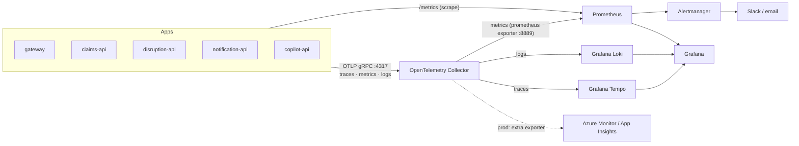

# Part 11 — Monitoring & Observability

## 11.1 Three pillars + how they connect

| Signal | Instrumentation | Backend | Key point |
|---|---|---|---|
| **Traces** | OTel .NET: ASP.NET Core, HttpClient, SqlClient, custom `ActivitySource` for Kafka/outbox/commands, MassTransit native, `Microsoft.Extensions.AI` | Tempo | `traceparent` propagated through **Kafka headers and outbox rows**, so a trace survives async hops (most portfolios break here). |
| **Metrics** | OTel meters: HTTP RED metrics, runtime (GC, threadpool), custom business metrics | Prometheus | Exemplars link a latency spike straight to a trace. |
| **Logs** | `ILogger` → OTel logs exporter (structured JSON); Serilog optional | Loki | Every log line carries `trace_id` / `span_id` → click from log to trace in Grafana. |

## 11.2 Custom business metrics (what Staff engineers actually look at)

| Metric | Type | Labels |
|---|---|---|
| `reroute_claims_filed_total` | Counter | `airline`, `eligible` |
| `reroute_compensation_amount_eur` | Histogram | `band` |
| `reroute_disruptions_detected_total` | Counter | `type` |
| `reroute_disruption_detection_latency_ms` | Histogram | — (feed timestamp → detected) |
| `reroute_outbox_pending` | Gauge | `service` |
| `reroute_outbox_oldest_age_seconds` | Gauge | `service` |
| `reroute_kafka_consumer_lag` | Gauge | `topic`, `group` |
| `reroute_llm_tokens_total` | Counter | `model`, `direction` |
| `reroute_rag_cache_hits_total` | Counter | — |

## 11.3 SLOs & alerts

| SLO | Target | Alert (multi-window burn rate) |
|---|---|---|
| Claims API availability (non-5xx) | 99.9 % / 30 d | 14.4× burn over 1 h **and** 5 m → page |
| Claims API latency | p99 < 300 ms | p99 > 300 ms for 10 m |
| Disruption → notification end-to-end | p95 < 5 s | p95 > 5 s for 10 m |
| Outbox freshness | oldest pending < 60 s | > 60 s for 5 m |
| DLQ | 0 messages | any message for 15 m → ticket |

Alert rules: [`deploy/observability/prometheus/alerts.yml`](../deploy/observability/prometheus/alerts.yml).

## 11.4 Grafana dashboards (provisioned from Git)
1. **Service overview (RED)** — rate, errors, duration per route, per service.
2. **Event pipeline** — Kafka lag per group, outbox pending/age, RabbitMQ queue depth, DLQ count.
3. **Business** — disruptions/min, claims filed, € compensation claimed, eligibility ratio.
4. **AI** — tokens, cost, latency, semantic cache hit rate, retrieval hit@k (from nightly eval).
5. **Runtime** — GC, allocations, threadpool queue, CPU/memory per pod.

## 11.5 Logging conventions
- Structured, message templates (`"Claim {ClaimId} filed by {TravellerId}"`), never string interpolation.
- No PII in logs (IBAN/email masked); `TravellerId` is a pseudonymous ID.
- Levels: `Information` for business events, `Warning` for handled anomalies, `Error` for failures needing action.
- Correlation: `trace_id` everywhere; gateway returns it as `X-Trace-Id` response header → users can quote it in support tickets.

## 11.6 Health checks
`/health/live` (process), `/health/ready` (SQL, Redis, Kafka producer, RabbitMQ), `/health/startup` (migrations done). Mapped to K8s probes (Part 9).

Next: [Part 12 — CI/CD](12-cicd.md)
